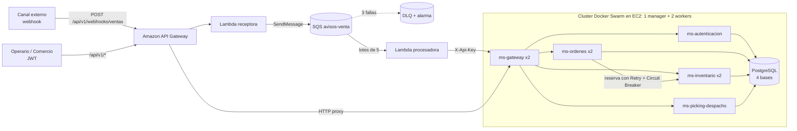

# doc · BodegaNube (JVY0101)

Documentación del equipo para la **Evaluación Parcial 3: Integración y Despliegue de Soluciones Cloud**.

| Documento | Contenido |
|---|---|
| [uso-de-ia.md](uso-de-ia.md) | Justificación del uso de Inteligencia Artificial de cada integrante: herramientas, etapas y prompts |
| Este README | Repositorios del sistema y mapa de evidencias de cada indicador de la pauta |

## Equipo
| Integrante | GitHub | Componentes a cargo |
|---|---|---|
| Lucas | [oLUCX](https://github.com/oLUCX) | ms-autenticacion, ms-gateway (JWT), Docker Swarm, Amazon API Gateway, organización y releases |
| Nicolás Bralla | [nbralla](https://github.com/nbralla) | ms-ordenes (reserva de stock), funciones Lambda, pruebas E2E y de carga |
| BOCAZ96 | [BOCAZ96](https://github.com/BOCAZ96) | ms-inventario, ms-picking-despacho, cola SQS, provisión de EC2 con CloudFormation |

## Repositorios
| Repositorio | Qué contiene |
|---|---|
| [ms-autenticacion](https://github.com/Caso-Bodega/ms-autenticacion) | Usuarios, login y emisión de JWT |
| [ms-gateway](https://github.com/Caso-Bodega/ms-gateway) | Spring Cloud Gateway: JWT, roles, Tenant Isolation y API key del webhook |
| [ms-ordenes](https://github.com/Caso-Bodega/ms-ordenes) | Órdenes, idempotencia y reserva de stock con Resilience4j |
| [ms-inventario](https://github.com/Caso-Bodega/ms-inventario) | Catálogo y stock con bloqueo de fila |
| [ms-picking-despacho](https://github.com/Caso-Bodega/ms-picking-despacho) | Picking, despacho y tracking |
| [bodeganube-serverless](https://github.com/Caso-Bodega/bodeganube-serverless) | Amazon API Gateway, cola SQS + DLQ y funciones Lambda |
| [bodeganube-infra](https://github.com/Caso-Bodega/bodeganube-infra) | Docker Compose, clúster Docker Swarm en EC2 y pruebas E2E |

## Arquitectura desplegada

## Mapa de evidencias (pauta EP3)
| IE | Indicador | Dónde está la evidencia |
|---|---|---|
| IE1 | Dockerfile funcional y optimizado | `Dockerfile` y `.dockerignore` de cada `ms-*` (multi-etapa, JRE alpine, usuario no root, healthcheck, capas) |
| IE2 | Contenedores en local y acceso a endpoints | `bodeganube-infra/docker-compose.yml` y la carpeta `postman/` de cada microservicio |
| IE3 | Docker Compose compatible con Swarm | `bodeganube-infra/docker-compose.swarm.yml` |
| IE4 | Pipeline CI/CD | `.github/workflows/ci-cd.yml` de cada `ms-*` (build, test, imagen en GHCR, despliegue) |
| IE5 | Etapas de provisión de servicios cloud | `infra.yml` (EC2 y clúster), `cola-sqs.yml` (SQS, DLQ, alarma), `lambdas.yml` (S3 y Lambdas), `api-gateway.yml` |
| IE6 | Pipelines ejecutados y servicio funcional en la nube | pestaña *Actions* de cada repositorio; etapa 3 verifica `/estado/<servicio>` |
| IE7 | Clúster Swarm con nodos manager y worker | `bodeganube-infra/swarm/scripts` y su README (añadir nodos manager y worker) |
| IE8 | Escalado de réplicas | `swarm/scripts/escalar.sh` y `pruebas/carga.ps1` |
| IE9 | Decisiones técnicas del clúster | README de bodeganube-infra, sección *Decisiones técnicas* |
| IE10 | Funciones serverless (FaaS) | `bodeganube-serverless/lambdas` y `cloudformation/02-lambdas.yaml` |
| IE11 | Cola en la nube para un requerimiento asíncrono | `cloudformation/01-cola-sqs.yaml` (requerimiento: responder al webhook de inmediato) |
| IE12 | API Gateway que protege el backend | `cloudformation/03-api-gateway.yaml` y `ms-gateway` (`JwtAutenticacionFilter`, `ApiKeyGatewayFilterFactory`) |
| IE13 | Integración FaaS con microservicios | `ProcesadorAvisosHandler` → ms-gateway → ms-ordenes → ms-inventario |
| IE14 | Productores y consumidores de la cola | `ReceptorWebhookHandler` (productor) y `ProcesadorAvisosHandler` (consumidor) |
| IE15 | Pruebas de extremo a extremo | `bodeganube-infra/pruebas/e2e.ps1` y `carga.ps1` |
| IE16-17 | Video | archivo `.mp4` entregado en AVA |
